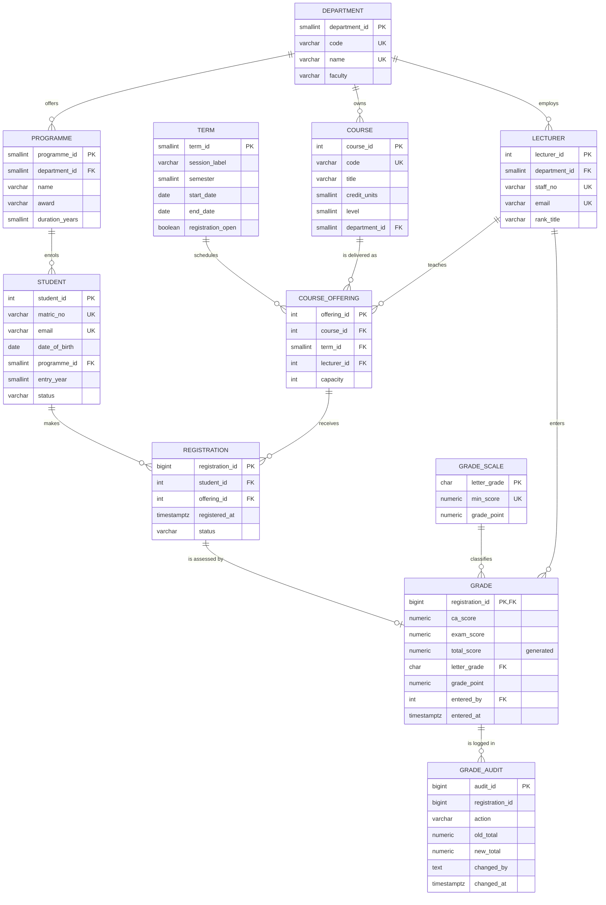

# Entity-Relationship Diagram

GitHub renders the Mermaid diagram below automatically. For the LMS write-up, take a screenshot of the rendered diagram (or paste the code into https://mermaid.live and export a PNG into `../screenshots/`).

**Reading the diagram.** `STUDENT` and `COURSE_OFFERING` have a many-to-many relationship, resolved by the associative entity `REGISTRATION`. `GRADE` shares its primary key with `REGISTRATION` (a one-to-zero-or-one relationship: a registration may not yet have a grade). `UK` = unique key, `FK` = foreign key.
